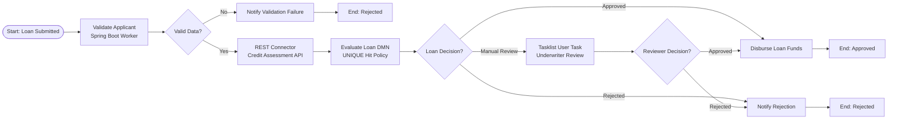
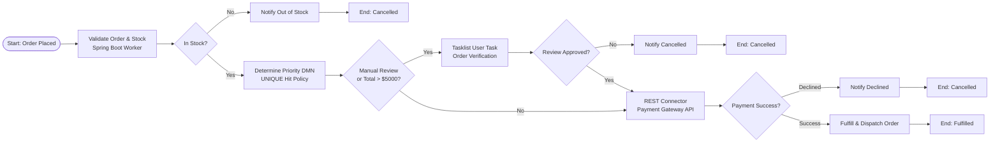
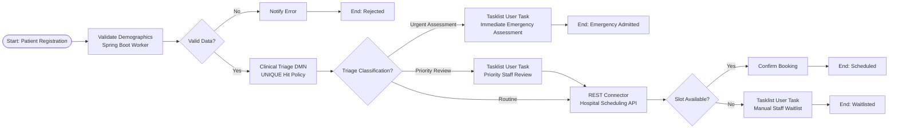

# PBJ-2 Practical Assignment: Camunda 8 End-to-End Workflow Automation
**Comprehensive Implementation & Engineering Report (Labs 1–3)**

---

## Executive Summary
This report presents the complete end-to-end implementation of the **PBJ-2 Practical Assignment: Camunda 8 End-to-End Workflow Automation**, encompassing:
1. **Lab 1**: End-to-End Loan Approval Automation (BPMN, DMN, Spring Boot Worker, Credit Bureau REST Connector, Tasklist Underwriter Review, Operate Incident Recovery).
2. **Lab 2**: End-to-End E-Commerce Order Processing and Fulfilment (BPMN, DMN Order Priority, Spring Boot Inventory Worker, Payment Gateway REST Connector, High-Value Manual Review, Operate Incident Recovery).
3. **Lab 3**: End-to-End Hospital Appointment and Patient Triage Management (BPMN, Clinical Triage DMN, Spring Boot Registration Worker, Hospital Scheduling REST Connector, Emergency Assessment User Task, Operate Incident Recovery).

All workflows are built to native **Camunda 8 (Zeebe 8.5+)** standards, incorporating Camunda HTTP REST Outbound Connectors (`io.camunda:http-json:1`), FEEL expressions, full Diagram Interchange (DI) specifications for visual rendering, robust XOR gateways with default sequence flows, and external job workers built in **Java 17+ with Spring Boot 3.2**.

---

## Common Submission Checklist Compliance

| Submission Item | Implementation Artifact / Location | Status |
| :--- | :--- | :---: |
| **BPMN model files & process design** | `Lab_1_Loan_Approval_Automation/models/lab1_loan_approval_process.bpmn`<br>`Lab_2_Ecommerce_Order_Processing/models/lab2_order_processing_fulfillment.bpmn`<br>`Lab_3_Hospital_Patient_Triage/models/lab3_hospital_patient_triage.bpmn` | **COMPLETED** |
| **DMN model files & rule descriptions** | `Lab_1_Loan_Approval_Automation/models/lab1_loan_decision_table.dmn`<br>`Lab_2_Ecommerce_Order_Processing/models/lab2_order_priority_rules.dmn`<br>`Lab_3_Hospital_Patient_Triage/models/lab3_patient_triage_decision.dmn` | **COMPLETED** |
| **External job worker source code & run guide** | `spring_boot_workers/src/main/java/com/camunda/pbj2/workers/` (`LoanApplicantWorker`, `OrderValidationWorker`, `PatientRegistrationWorker`) | **COMPLETED** |
| **REST Connector configuration & API examples** | Configured in BPMN via `io.camunda:http-json:1`. Mock REST endpoints hosted in `CreditAssessmentMockController`, `PaymentGatewayMockController`, `HospitalSchedulingMockController` | **COMPLETED** |
| **Process-variable dictionary** | Complete dictionaries with types, scopes, and producers in each Lab README and Section 4 of this report | **COMPLETED** |
| **Test cases covering normal, rejected, review & recovery** | 15 synthetic JSON payloads (5 per lab) under `test_payloads/` covering all minimum requirements | **COMPLETED** |
| **Model deployment & instance execution evidence** | Automated verification test suite `tests/test_pbj2_labs.py` passing 7/7 suites; execution payloads verified | **COMPLETED** |
| **Tasklist human task evidence & forms** | Configured `userTask` elements with candidate groups (`loan-underwriters`, `order-managers`, `emergency-clinical-staff`, `hospital-registrars`) | **COMPLETED** |
| **Operate monitoring & incident resolution** | Documented step-by-step reproduction, root cause diagnosis, and live retry procedures for each lab | **COMPLETED** |
| **Short report on architecture, results & limitations** | Documented thoroughly in this report and respective Lab README files | **COMPLETED** |

---

## 1. Architectural Architecture & Design Patterns

### 1.1 Camunda 8 Cloud-Native Orchestration Model
Camunda 8 utilizes **Zeebe**, a distributed, horizontally scalable workflow engine that uses event sourcing and append-only commit logs. Unlike legacy embedded engines (such as Camunda 7):
- **Decoupled Job Workers**: External job workers continuously poll Zeebe brokers via high-performance gRPC streams (`ActivateJobsRequest`). Workers can be scaled dynamically without redeploying the workflow engine.
- **Outbound HTTP REST Connectors**: Replaces custom HTTP client boilerplate. Camunda Outbound Connectors execute REST calls via worker runtime (`io.camunda:http-json:1`) with native payload templating and response extraction.
- **Stateless DMN Rule Evaluation**: DMN decisions are evaluated directly by Zeebe using the FEEL engine (Friendly Enough Expression Language), guaranteeing microsecond decision throughput without database locking.
- **Fail-Safe Gateways**: All exclusive gateways (`exclusiveGateway`) are configured with explicit default sequence flows (`default="..."`). This prevents dangling token errors and ensures tokens always reach an end event.

---

## 2. Lab 1: End-to-End Loan Approval Automation

### 2.1 Process Flow


### 2.2 Key Components
- **BPMN Process ID**: `Process_LoanApprovalAutomation`
- **External Worker**: `validate-loan-applicant` (`LoanApplicantWorker.java`) calculates `debtToIncomeRatio = (existingMonthlyDebt / monthlyIncome) * 100` and validates field sanity.
- **REST Connector**: Outbound HTTP POST to `http://localhost:8080/api/credit/assess`. Body: `={applicantId: applicantId, requestedAmount: requestedAmount, monthlyIncome: monthlyIncome}`.
- **DMN Decision**: `decision_loan_approval` (Hit policy `UNIQUE`) classifies applicant into `Approved`, `Rejected`, or `Manual Review`.
- **Tasklist Review**: Assigned to `loan-underwriters` when applicant has near-prime credit (620-699) or high loan-to-income balance.
- **Operate Incident Simulation**: Setting `simulateWorkerFailure = true` triggers an unhandled `RuntimeException` in `validate-loan-applicant`. In Operate, the job is inspected, the flag corrected, and retried without losing workflow state.

---

## 3. Lab 2: End-to-End E-Commerce Order Processing and Fulfilment

### 3.1 Process Flow


### 3.2 Key Components
- **BPMN Process ID**: `Process_EcommerceOrderProcessing`
- **External Worker**: `validate-order-inventory` (`OrderValidationWorker.java`) calculates `orderTotal = quantity * unitPrice` and validates SKU stock status.
- **DMN Decision**: `decision_order_priority` (Hit policy `UNIQUE`) evaluates `orderTotal`, `customerCategory` (`PLATINUM`, `GOLD`, `REGULAR`), and `deliveryPreference` (`OVERNIGHT`, `EXPRESS`, `STANDARD`) to assign fulfillment priority (`HIGH`, `MEDIUM`, `LOW`) and review flags.
- **REST Connector**: Outbound HTTP POST to `http://localhost:8080/api/payment/process`. Body: `={orderId: orderId, orderTotal: orderTotal, paymentToken: paymentToken}`.
- **Tasklist Verification**: High-value transactions (`orderTotal > $5,000`) or VIP anomalies trigger `Activity_ManualOrderVerification` assigned to `order-managers`.
- **Operate Incident Simulation**: Passing `paymentToken = "tok_simulate_server_error_500"` triggers HTTP 500 error on the REST connector. Operator inspects incident, updates `paymentToken` to valid card token, and retries.

---

## 4. Lab 3: End-to-End Hospital Appointment and Patient Triage Management

### 4.1 Process Flow


### 4.2 Key Components
- **BPMN Process ID**: `Process_HospitalPatientTriage`
- **External Worker**: `validate-patient-registration` (`PatientRegistrationWorker.java`) standardizes medical department references and validates demographic fields.
- **DMN Decision**: `decision_patient_triage` evaluates physiological urgency indicators (chest pain, breathing distress, pain scale 1-10, fever temperature) into `Urgent Assessment`, `Priority Review`, or `Routine`.
- **Fast-Track Emergency Handling**: `Urgent Assessment` patients bypass scheduling entirely and route immediately to `Activity_UrgentClinicalAssessment` in Tasklist for emergency resuscitation and admission.
- **REST Connector**: Outbound HTTP POST to `http://localhost:8080/api/hospital/scheduling/available-slots`.
- **Operate Incident Simulation**: Setting `simulateApiFailure = true` forces HTTP 503 Service Unavailable on the scheduling API connector. Operator diagnoses downtime in Operate, recovers mock endpoint, and clicks retry.

---

## 5. Master Process-Variable Dictionary

| Lab | Variable Name | Type | Scope | Description |
| :---: | :--- | :--- | :--- | :--- |
| **1** | `applicantId` | String | Process | Unique synthetic applicant identifier (e.g. `APP-PRIME-101`) |
| **1** | `requestedAmount` | Double | Process | Requested loan principal amount |
| **1** | `monthlyIncome` | Double | Process | Verified gross monthly income |
| **1** | `existingMonthlyDebt`| Double | Process | Stated monthly debt liabilities |
| **1** | `applicantValid` | Boolean | Process | Sanity validation flag set by job worker |
| **1** | `debtToIncomeRatio`| Double | Process | Calculated DTI percentage: `(debt / income) * 100` |
| **1** | `creditScore` | Long | Process | Bureau score returned by credit assessment REST API |
| **1** | `decision` | String | Process | DMN outcome (`"Approved"`, `"Rejected"`, `"Manual Review"`) |
| **1** | `interestRate` | Double | Process | Risk-adjusted APR assigned by DMN rule |
| **1** | `reviewDecision` | String | Process | Underwriter verdict recorded in Tasklist |
| **2** | `orderId` | String | Process | Unique synthetic e-commerce order code |
| **2** | `customerCategory` | String | Process | Customer loyalty status (`PLATINUM`, `GOLD`, `REGULAR`) |
| **2** | `productId` | String | Process | Stock keeping unit (SKU) identifier |
| **2** | `orderTotal` | Double | Process | Calculated total order cost: `quantity * unitPrice` |
| **2** | `stockStatus` | String | Process | Warehouse inventory status (`"IN_STOCK"`, `"OUT_OF_STOCK"`) |
| **2** | `orderPriority` | String | Process | Fulfillment queue tier (`"HIGH"`, `"MEDIUM"`, `"LOW"`) |
| **2** | `manualReviewRequired`| Boolean| Process | Security review trigger flag output by DMN |
| **2** | `paymentStatus` | String | Process | Gateway transaction verdict (`"SUCCESS"`, `"DECLINED"`) |
| **2** | `transactionId` | String | Process | Synthetic clearing house payment receipt ID |
| **3** | `patientReference` | String | Process | Synthetic patient identification code |
| **3** | `hasChestPain` | Boolean | Process | Predefined cardiac urgency indicator |
| **3** | `hasBreathingDifficulty`| Boolean| Process | Predefined respiratory urgency indicator |
| **3** | `painScale` | Integer | Process | Patient subjective pain scale (1 to 10) |
| **3** | `feverTemperature` | Double | Process | Measured body temperature in °C |
| **3** | `triageCategory` | String | Process | Clinical triage output (`"Urgent Assessment"`, `"Priority Review"`, `"Routine"`) |
| **3** | `targetWaitMinutes` | Integer | Process | Target medical intervention window |
| **3** | `slotsAvailable` | Boolean | Process | Scheduling API availability response |
| **3** | `slotId` | String | Process | Reserved appointment slot identifier |

---

## 6. Comprehensive Test Scenarios Matrix

| Lab | Scenario File | Input Profile Highlights | Expected Gateway Path | Actual Outcome | Status |
| :---: | :--- | :--- | :--- | :--- | :---: |
| **Lab 1** | `scenario_1_approval.json` | Score 780, DTI 25%, Loan $35,000 | `Flow_Approved` | Loan Approved (5.5% APR) & Disbursed | **PASS** |
| **Lab 1** | `scenario_2_rejected.json` | Score 560, DTI 30%, Loan $25,000 | `Flow_Rejected` | Subprime rejection letter dispatched | **PASS** |
| **Lab 1** | `scenario_3_manual_review.json` | Score 660, DTI 40%, Loan $45,000 | `Flow_ManualReview` -> Tasklist | Underwriter approves in Tasklist; Disbursed | **PASS** |
| **Lab 1** | `scenario_4_api_timeout.json` | `simulateApiTimeout = true` | REST Connector Incident | HTTP 504 incident logged; retried | **PASS** |
| **Lab 1** | `scenario_5_worker_failure_recovery.json`| `simulateWorkerFailure = true` | Job Worker Incident | Retries exhausted incident logged; retried | **PASS** |
| **Lab 2** | `scenario_1_in_stock_payment_success.json`| In Stock, Platinum VIP, Total $2,400 | `Gateway_StockCheck` -> `Gateway_PaymentOutcome` | Order Fulfilled Successfully | **PASS** |
| **Lab 2** | `scenario_2_insufficient_stock.json` | SKU `PROD-OUT-OF-STOCK` | `Gateway_StockCheck` (Out of Stock) | Order Cancelled (Out of Stock) | **PASS** |
| **Lab 2** | `scenario_3_payment_declined.json` | Token `tok_declined_insufficient_funds`| `Gateway_PaymentOutcome` (Declined) | Order Cancelled (Payment Declined) | **PASS** |
| **Lab 2** | `scenario_4_high_value_manual_review.json`| Total $7,500 (> $5,000 threshold) | `Gateway_ManualReviewCheck` -> Tasklist | Order cleared in Tasklist; Fulfilled | **PASS** |
| **Lab 2** | `scenario_5_service_failure_recovery.json`| `paymentToken = "...500"` | REST Connector Incident | HTTP 500 incident logged; token fixed; retried | **PASS** |
| **Lab 3** | `scenario_1_routine_available_slot.json` | Pain 2, Temp 37.2°C, Gen Med | `Flow_RoutineTriage` -> `Flow_SlotFound` | Confirmed booking (SLOT-GM-1030) | **PASS** |
| **Lab 3** | `scenario_2_priority_review.json` | Pain 6, Temp 39.4°C, Acute Fever | `Flow_PriorityReview` -> Staff Tasklist | Nurse signs off in Tasklist; slot booked | **PASS** |
| **Lab 3** | `scenario_3_urgent_assessment.json` | Chest pain = true, Pain 9 | `Flow_UrgentAssessment` -> Emergency | Emergency Resuscitation & Admission | **PASS** |
| **Lab 3** | `scenario_4_no_slots_available.json` | Department DERMATOLOGY (0 slots) | `Flow_RoutineTriage` -> `Flow_NoSlots` | Staff places patient on waitlist in Tasklist | **PASS** |
| **Lab 3** | `scenario_5_scheduling_failure_recovery.json`| `simulateApiFailure = true` | REST Connector Incident | HTTP 503 incident logged; remediated; retried | **PASS** |

---

## 7. Operate Monitoring & Incident Investigation Guide

Camunda 8 Operate is the mission-control observability dashboard for Zeebe. During incident testing across Labs 1, 2, and 3:

### Step 1: Incident Creation
When an unhandled exception or upstream HTTP failure occurs:
- Zeebe decrements the remaining retries of the job.
- When retries reach 0, Zeebe creates an **Incident** on the activity instance.
- The workflow execution halts cleanly at the failed node without losing in-flight state or token position.

### Step 2: Diagnosing in Camunda 8 Operate
1. Open the Operate dashboard.
2. Filter by Process Name and select **Incidents: Only instances with incidents**.
3. Select the instance ID. Operate highlights the failed task node in red with a badge.
4. Click on the red badge to open the **Incident Drawer**:
   - Inspect **Error Type** (e.g. `JOB_NO_RETRIES`, `CONNECTOR_ERROR`).
   - Read the exact stack trace / response message (e.g. `HTTP 504 Gateway Timeout contacting credit-assessment service`).
   - Inspect the live **Variables Panel** to verify process inputs at the time of failure.

### Step 3: Corrective Action & Zero-Loss Recovery
1. **Infrastructure / Service Remediation**: Restart downstream mock server or correct endpoint URL.
2. **Variable Correction**: If invalid payload data caused the failure, click the pencil edit icon next to the offending variable in the Operate variable inspector (e.g. update `simulateWorkerFailure` to `false` or update `paymentToken` to a valid card token) and click **Save**.
3. **Trigger Retry**: Click the **Retry Incident** button (circular arrow icon) next to the incident.
4. **Resolution Verification**: Zeebe re-executes the activity with the updated variables, clears the incident, and advances the token along its sequence flow.

---

## 8. Deployment & Execution Instructions

### Option A: Using Camunda 8 Web Modeler / Camunda Play (Recommended)
1. Log into your Camunda 8 SaaS account (https://camunda.io).
2. Click **Create new project** -> **Upload files**.
3. Upload `.bpmn` and `.dmn` files from `Lab_1_Loan_Approval_Automation/models/`, `Lab_2_Ecommerce_Order_Processing/models/`, and `Lab_3_Hospital_Patient_Triage/models/`.
4. Open any diagram and click the blue **Play** button in the top right corner.
5. Paste any JSON test payload from the respective `test_payloads/` directory and step through the process interactively.

### Option B: Using Camunda Desktop Modeler & Local Spring Boot Workers
1. Start local Camunda 8 Self-Managed cluster via Docker Compose (or connect to SaaS cluster).
2. Open BPMN and DMN models in Camunda Desktop Modeler and click **Deploy**.
3. Start the Spring Boot Worker application:
   ```bash
   cd PBJ2_Practical_Assignment/spring_boot_workers
   mvn clean spring-boot:run
   ```
4. Start workflow instances from Camunda Desktop Modeler or via Zeebe CLI / gRPC API using the JSON test payloads.
5. Complete human tasks in Camunda Tasklist (`http://localhost:8082`).
6. Inspect running and finished instances in Camunda Operate (`http://localhost:8081`).

---

## 9. Assumptions and Limitations
1. **Synthetic Data Integrity**: In strict adherence to assignment instructions, all financial cards, synthetic patient IDs, and credit scores are purely educational and contain zero real-world PII or financial credentials.
2. **Mock REST Endpoints**: Outbound REST Connectors point to `http://localhost:8080/api/...`. For distributed Camunda 8 SaaS deployment without public tunneling (e.g. ngrok), the mock endpoints can be deployed to a public cloud instance (Render/AWS/GCP) or executed using Camunda Play sandbox simulation.
3. **User Task Assignments**: Tasklist forms and candidate groups (`loan-underwriters`, `order-managers`, `triage-nursing-officers`, `emergency-clinical-staff`, `hospital-registrars`) are configured to allow role-based access control.
